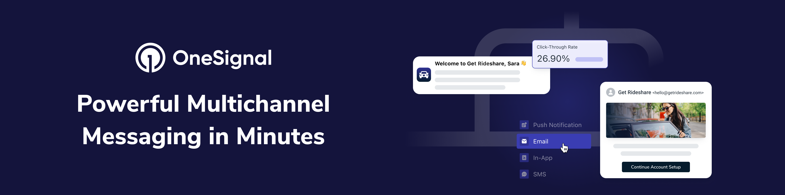

  <h1>OneSignal</h1>

   
  <a href="https://documentation.onesignal.com/docs/en/quickstart-guide" target="_blank">Quickstart</a>
  &nbsp;&nbsp;•&nbsp;&nbsp;
  <a href="https://onesignal.com/" target="_blank">Website</a>
  &nbsp;&nbsp;•&nbsp;&nbsp;
  <a href="https://documentation.onesignal.com/" target="_blank">Docs</a>
   
  

# 👋 Welcome

OneSignal makes engaging customers simple and is the fastest, most reliable service to send push notifications, in-app messages, SMS, and emails.

# :octocat: Code Repositories

OneSignal provides code repositories through two GitHub Organizations:

- Official OneSignal SDKs & Tooling are avialable through this organization and are listed in our [SDKs](https://github.com/OneSignal/sdks) repository.

# ❤️ Developer Community

Get in touch with us or learn more about OneSignal through the channels below.

- [Follow us on Twitter](https://twitter.com/onesignal) to never miss any updates from the OneSignal team, ecosystem & community
- [Read the OneSignal Blog](https://onesignal.com/blog/) for the latest announcements, tutorials, in-depth articles & more.
- [Subscribe to us on YouTube](https://www.youtube.com/channel/UCe63d5EDQsSkOov-bIE_8Aw/featured) for walkthroughs, courses, talks, workshops & more.

# :rocket: Careers

Are you interested in delivering customer messages at scale? Check out our [Careers](http://onesignal.com/careers) and join our fast-growing team and help us continue to build the most widely-used customer engagement solution!
